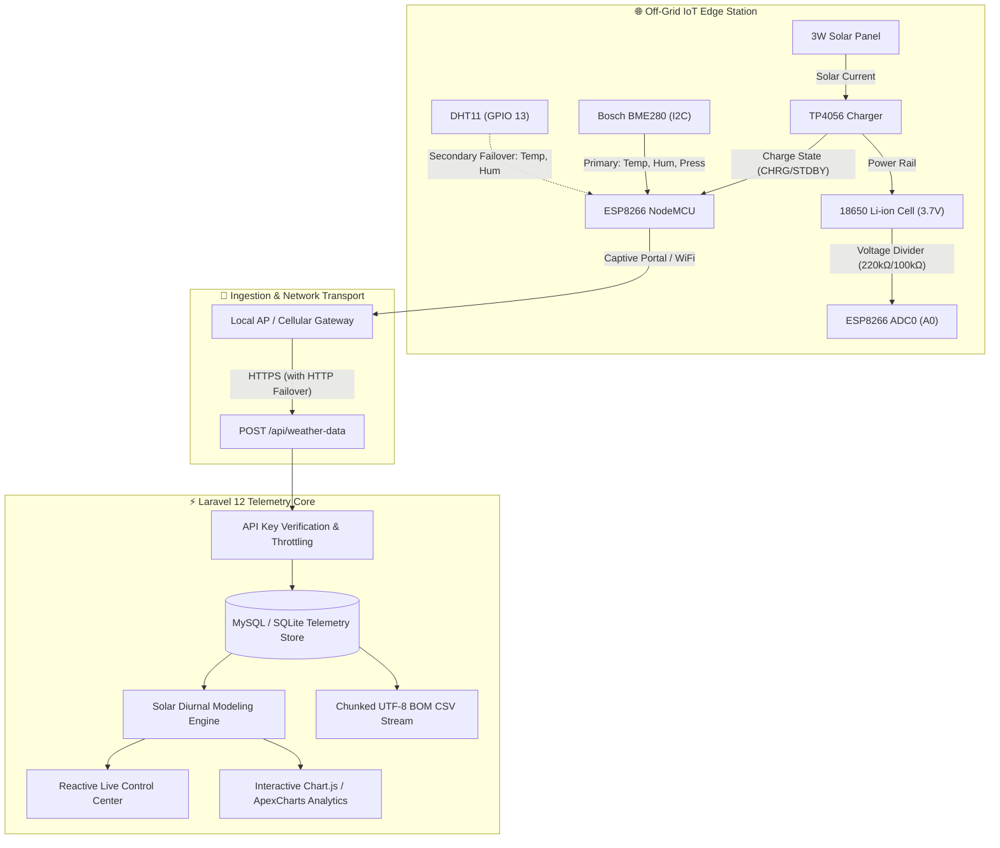
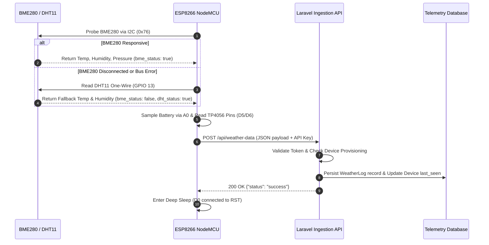

<p align="center">
  <a href="https://github.com/niteshk700/solar">
    
  </a>
</p>

<h1 align="center">☀️ Solar IoT Telemetry & Control Center</h1>

<p align="center">
  <strong>An enterprise-grade, solar-powered environmental monitoring platform featuring dual-sensor hardware failover, real-time reactive telemetry streaming, high-precision solar yield modeling, and PWA capabilities.</strong>
</p>

<p align="center">
  <a href="https://github.com/niteshk700/solar/actions"></a>
  <a href="https://laravel.com"></a>
  <a href="https://php.net"></a>
  <a href="https://www.mysql.com"></a>
  <a href="https://espressif.com"></a>
  <a href="https://chartjs.org"></a>
  <a href="LICENSE"></a>
</p>

<p align="center">
  <a href="#-architecture--data-flow">Architecture</a> •
  <a href="#-key-features">Key Features</a> •
  <a href="#-hardware-schematic--pinout">Hardware Wiring</a> •
  <a href="#-quick-start-guide">Quick Start</a> •
  <a href="#-rest-api-documentation">REST API</a> •
  <a href="#-firmware-guide">Firmware</a> •
  <a href="#-test-suite">Testing</a>
</p>

---

## 🌟 Highlights

- ⚡ **Autonomous Off-Grid Operation:** Custom 3W solar PV + TP4056 lithium charging module powering an ESP8266 node with low-power deep sleep cycles.
- 🛡️ **Dual-Sensor Hardware Failover:** Automatic fallback from Bosch BME280 (I2C) to DHT11 digital one-wire bus if sensor I/O disconnection or packet checksum errors occur.
- 📈 **Real-Time Reactive Streaming:** Micro-polling live engine with visual flash cues and dual-axis Chart.js telemetry without browser refresh.
- ☀️ **100kW Diurnal Solar Power Engine:** Mathematical model computing Active Power ($kW$), Daily Yield ($kWh$), Specific Yield ($kWh/kWp$), Avoided $CO_2$ (Tonnes), and Capacity Utilization Factor ($CUF$).
- 📱 **Progressive Web App (PWA):** Zero-install, mobile-optimized experience with service workers and asset caching on iOS, Android, and Desktop.
- 🔒 **Enterprise Security:** Token-authenticated REST ingestion with cryptographic token hashing and role-based session isolation.

---

## 🏗️ Architecture & Data Flow



### Telemetry & Redundancy Protocol



---

## ✨ Key Features

| Category | Capability | Description |
| :--- | :--- | :--- |
| **Edge Hardware** | Dual-Sensor Redundancy | Bosch BME280 primary with automatic fallback to DHT11 digital one-wire bus. |
| **Power Management** | Battery & Solar State | 18650 Li-ion voltage reading via scaled resistor divider + TP4056 digital pin sensing (`CHRG`, `STDBY`). |
| **Zero-Config Setup** | WiFiManager Hotspot | Creates `Solar_Weather_Setup` captive portal upon unconfigured WiFi boot with a 3-minute power timeout. |
| **Control Center** | Reactive Micro-Polling | 3-second live AJAX delta polling, value flash animations, and high-visibility status badges. |
| **Solar Modeling** | Diurnal Simulation | $P(t) = P_{\text{max}} \cdot \sin(\theta)$ solar curve calculation with realistic $\pm 4\%$ irradiance jitter. |
| **Time-Series Charts** | Responsive Analytics | Multi-series historical plots ($24\text{h}$, $7\text{d}$, $30\text{d}$) with automatic adaptive server-side downsampling. |
| **Data Export** | Streaming CSV | High-throughput streaming CSV exports with UTF-8 BOM encoding for seamless Microsoft Excel compatibility. |
| **Security** | Secure Ingestion | Device-bound API tokens, session-based authentication, and protected admin endpoints. |

---

## 🔌 Hardware Schematic & Pinout

### NodeMCU (ESP8266) Wiring Map

```
                +---------------------+
                |   ESP8266 NodeMCU   |
                |                     |
   3.3V --------| 3V3             VIN |-------- TP4056 OUT+ (4.2V - 5V)
    GND --------| GND             GND |-------- Common System Ground
 BME SCL -------| D1 (GPIO 5)     RST |---+---- Deep Sleep Trigger
 BME SDA -------| D2 (GPIO 4)     D0  |---+     (GPIO 16)
TP CHRG --------| D5 (GPIO 14)        |
TP STDBY -------| D6 (GPIO 12)        |
DHT DATA -------| D7 (GPIO 13)        |
Divider Out ----| A0 (ADC0)           |
                +---------------------+
```

### Complete Pin Assignment Table

| Module | Module Pin | ESP8266 Pin | Function / Logic |
| :--- | :--- | :--- | :--- |
| **Bosch BME280** | `VCC` / `GND` | `3V3` / `GND` | Regulated 3.3V supply and common ground |
| | `SCL` | `D1` (GPIO 5) | I2C Clock Line (Standard 100kHz / 400kHz) |
| | `SDA` | `D2` (GPIO 4) | I2C Data Line |
| **DHT11 Sensor** | `VCC` / `GND` | `3V3` / `GND` | Redundant backup sensor power |
| | `DATA` | `D7` (GPIO 13) | One-Wire digital bus with 10kΩ pull-up |
| **TP4056 Charger** | `IN+` / `IN-` | Solar Panel (+ / -) | 5V / 3W Monocrystalline PV input |
| | `BAT+` / `BAT-` | 18650 Battery (+ / -)| 3.7V Lithium-ion cell |
| | `OUT+` / `OUT-` | `VIN` / `GND` | System power feed to ESP8266 internal LDO |
| | `CHRG` (Pin 7) | `D5` (GPIO 14) | Active LOW when battery is actively charging |
| | `STDBY` (Pin 6) | `D6` (GPIO 12) | Active LOW when battery charging is complete |
| **Voltage Divider** | `BAT+` $\rightarrow$ `220kΩ` | `A0` (ADC0) | Scaled cell voltage ($3.0\text{V} - 4.2\text{V} \to 0.93\text{V} - 1.31\text{V}$) |
| | `A0` $\rightarrow$ `100kΩ` | `GND` | Pull-down leg of the voltage divider |
| **Deep Sleep Link**| `D0` (GPIO 16) | `RST` | RTC alarm pull-down line to wake MCU |

> [!CAUTION]
> **Flashing Precaution:** Disconnect the jumper between **`D0`** and **`RST`** when uploading firmware via USB. Having this connected holds the reset circuit and blocks UART programming.

---

## 🚀 Quick Start Guide

### System Requirements
- **PHP:** `^8.3` (extensions: `pdo_mysql` or `pdo_sqlite`, `mbstring`, `openssl`, `curl`)
- **Composer:** `^2.x`
- **Node.js:** `^20.x` & **npm:** `^10.x`
- **Database:** MySQL 8.0+ or SQLite 3

### 1. Clone & Install Dependencies
```bash
git clone https://github.com/niteshk700/solar.git
cd solar

# Install PHP dependencies
composer install --no-dev --optimize-autoloader

# Install front-end dependencies & build assets
npm install
npm run build
```

### 2. Configure Environment
```bash
cp .env.example .env
php artisan key:generate
```

Adjust your `.env` configuration file:
```ini
APP_NAME="Solar IoT Weather Platform"
APP_ENV=local
APP_DEBUG=false
APP_URL=http://localhost:8000

# Database Configuration (MySQL recommended for production)
DB_CONNECTION=mysql
DB_HOST=127.0.0.1
DB_PORT=3306
DB_DATABASE=solar
DB_USERNAME=root
DB_PASSWORD=your_password
```

### 3. Run Migrations & Seed Default Data
```bash
php artisan migrate --seed
```

> [!NOTE]
> **Default Admin Credentials:**
> - **URL:** `http://localhost:8000/login`
> - **Email:** `admin@solar.yourdev.in`
> - **Password:** `admin123`
> - **Default Device ID:** `solar_data_collector_v1`
> - **Device API Key:** `SolarDataCollectionV1`

### 4. Start the Application
```bash
php artisan serve
```
Open **`http://localhost:8000`** in your browser.

---

## 📡 REST API Documentation

### 1. Telemetry Ingestion
Transmit real-time telemetry from edge devices to the platform.

```http
POST /api/weather-data
Content-Type: application/json
```

#### Request Payload
```json
{
  "api_key": "SolarDataCollectionV1",
  "device_id": "solar_data_collector_v1",
  "temperature": 27.85,
  "humidity": 58.40,
  "pressure": 1012.65,
  "battery": 4.14,
  "rssi": -65,
  "bme_status": true,
  "dht_status": true,
  "solar_status": "charging"
}
```

#### Response (`200 OK`)
```json
{
  "status": "success",
  "message": "Data stored successfully"
}
```

#### Example cURL Request
```bash
curl -X POST http://localhost:8000/api/weather-data \
  -H "Content-Type: application/json" \
  -d '{
    "api_key": "SolarDataCollectionV1",
    "device_id": "solar_data_collector_v1",
    "temperature": 27.85,
    "humidity": 58.4,
    "pressure": 1012.65,
    "battery": 4.14,
    "rssi": -65,
    "bme_status": true,
    "dht_status": true,
    "solar_status": "charging"
  }'
```

---

### 2. Fetch Latest Device Telemetry
```http
GET /api/device/{device_id}/latest
```

#### Response (`200 OK`)
```json
{
  "status": "success",
  "device": {
    "device_id": "solar_data_collector_v1",
    "device_name": "Solar Data Collector v1",
    "status": "active",
    "last_seen": "2026-11-17T15:45:00+05:30"
  },
  "data": {
    "temperature": 27.85,
    "humidity": 58.4,
    "pressure": 1012.65,
    "battery": 4.14,
    "rssi": -65,
    "solar_status": "charging"
  }
}
```

---

### 3. Fetch Historical Device Data
```http
GET /api/device/{device_id}/history?hours=24
```

| Parameter | Type | Default | Description |
| :--- | :--- | :--- | :--- |
| `hours` | `integer` | `24` | Historical window in hours (range: $1$ to $720$) |

---

## 💾 Firmware Guide

The edge firmware is located in [`firmware/solar_bme280_firmware/solar_bme280_firmware.ino`](firmware/solar_bme280_firmware/solar_bme280_firmware.ino).

### Required Arduino Libraries
Install via the Arduino Library Manager (`Ctrl + Shift + I` / `Cmd + Shift + I`):
1. **Adafruit BME280 Library** (by Adafruit)
2. **Adafruit Unified Sensor** (by Adafruit)
3. **DHT sensor library** (by Adafruit)
4. **ArduinoJson** (v6.x or v7.x by Benoit Blanchon)
5. **WiFiManager** (by tzapu)

### Flash & Provisioning Steps
1. Open the `.ino` file in the Arduino IDE.
2. Update the configuration constants:
   ```cpp
   const char* serverUrl = "http://your-server-ip:8000/api/weather-data";
   const char* deviceId  = "solar_data_collector_v1";
   const char* apiKey    = "SolarDataCollectionV1";
   ```
3. Set your target board to **NodeMCU 1.0 (ESP-12E Module)** with default flash settings ($80\text{MHz}$, $4\text{MB}$ flash).
4. Verify that `D0` to `RST` wire is **unplugged**. Connect the USB cable and click **Upload**.
5. Once flashed, reconnect `D0` to `RST` for deep sleep support.
6. Connect to the initial captive portal hotspot named **`Solar_Weather_Setup`** on your smartphone/laptop and submit your local WiFi credentials.

---

## 🗂️ Project Structure

```text
├── app/
│   ├── Http/Controllers/
│   │   ├── ApiController.php          # REST ingestion and retrieval endpoints
│   │   ├── AuthController.php         # Authentication and session control
│   │   ├── DashboardController.php    # Live control center & CSV exports
│   │   ├── DeviceController.php       # Hardware node CRUD & time-series analytics
│   │   └── SettingsController.php     # Profile security & API key generation
│   ├── Models/
│   │   ├── Device.php                 # Registered hardware node model
│   │   ├── WeatherLog.php             # Raw time-series telemetry records
│   │   └── ApiToken.php               # Hashed REST API tokens
│   └── Services/
│       └── SolarSimulationService.php # Diurnal solar yield mathematical model
├── database/
│   ├── migrations/                    # Database table schemas
│   └── seeders/                       # Default admin and telemetry node seeds
├── firmware/
│   └── solar_bme280_firmware/
│       └── solar_bme280_firmware.ino  # Embedded ESP8266 C++ firmware
├── public/
│   ├── icons/                         # Platform logos and PWA iconography
│   ├── manifest.json                  # PWA application manifest
│   └── sw.js                          # Service worker background cache
├── resources/
│   └── views/
│       ├── auth/                      # Sleek monochrome login views
│       ├── dashboard/                 # Dynamic live control center
│       ├── devices/                   # Device manager & analytics charts
│       └── layouts/                   # Master app shell
├── routes/
│   ├── api.php                        # Ingestion and telemetry REST routes
│   └── web.php                        # Web platform authenticated routes
└── tests/
    └── Feature/                       # Automated integration & feature tests
```

---

## 🧪 Test Suite

The platform includes automated feature test coverage ensuring route authentication, device management, and telemetry integrity remain robust.

```bash
php artisan test
```

Expected output:
```text
PASS  Tests\Feature\ExampleTest
✓ login screen can be rendered
✓ user can authenticate using the login screen
✓ guest is redirected to login from dashboard
✓ authenticated user can access dashboard
✓ authenticated user can view devices page
✓ authenticated user can view settings page

Tests:    6 passed (7 assertions)
Duration: 0.14s
```

---

## 📄 License

Distributed under the **MIT License**. See [`LICENSE`](LICENSE) for complete details.

---

<p align="center">
  Crafted for <strong>Nitra Technical Campus Solar IoT Portal</strong> &bull; Developed by <a href="https://github.com/niteshk700">Nitesh Kumar</a>
</p>
