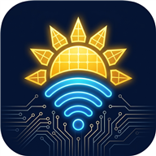
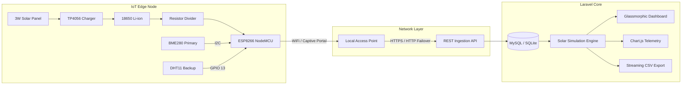

# ☀️ Solar IoT Weather Platform & Telemetry Station

<p align="center">
  
</p>

<p align="center">
  <strong>An enterprise-grade, solar-powered environmental telemetry platform with dual-sensor hardware failover, real-time analytics, and high-precision solar yield modeling.</strong>
</p>

<p align="center">
  <a href="https://laravel.com"></a>
  <a href="https://php.net"></a>
  <a href="https://espressif.com"></a>
  <a href="https://getbootstrap.com"></a>
  <a href="https://chartjs.org"></a>
  <a href="https://developer.mozilla.org/en-US/docs/Web/Progressive_web_apps"></a>
</p>

---

## 📖 Overview

The **Solar IoT Weather Platform** is a full-stack IoT telemetry ecosystem designed for remote environmental monitoring and solar energy analytics. It bridges embedded sensor hardware (ESP8266 + Bosch BME280 + DHT11) with a reactive Laravel web application, offering live dashboards, historical time-series analytics, failover redundancy diagnostics, and mathematical solar generation modeling.



---

## ✨ Key Features

### 🔌 Embedded Hardware & Firmware
- **Dual-Sensor Redundancy with Automatic Failover:**
  - **Primary:** Bosch BME280 sensor via I2C (temperature, humidity, atmospheric pressure).
  - **Secondary:** DHT11 digital bus backup. If the BME280 disconnects or fails, telemetry seamlessly falls back to DHT11 without telemetry interruption.
- **Solar & Battery Management:**
  - **TP4056 Real-Time Monitoring:** Digital reading of charging (`CHRG`) and standby/full (`STDBY`) states.
  - **18650 Battery Voltage Divider:** Dual-resistor divider ($220\,\text{k}\Omega / 100\,\text{k}\Omega$) reading cell voltage ($3.0\,\text{V} - 4.2\,\text{V}$) via analog pin `A0`.
- **Zero-Friction WiFi Setup:**
  - **WiFiManager Captive Portal:** Creates `Solar_Weather_Setup` hotspot when unconfigured, with a 3-minute battery-saving timeout.
- **Robust Network Telemetry:**
  - **Self-Healing Ingestion:** Tries secure HTTPS with TLS bypass, immediately falling back to standard HTTP if heap memory or network conditions constrain SSL handshakes.

### 📊 Backend & Web Platform
- **Real-Time Live Dashboard:**
  - Glassmorphic UI styled with Bootstrap 5 and FontAwesome 6.
  - Auto-updating telemetry stream via lightweight AJAX polling without page reloads.
  - Dynamic fleet health summaries (online, offline, and inactive nodes).
- **Solar Generation Simulation Service:**
  - Analytical solar power curve modeling ($P_{\text{max}} = E_{\text{day}} \cdot \frac{\pi}{24}$, sinusoidal diurnal tracking).
  - Deterministic minute-level sensor jitter ($\pm 4\%$) for realistic real-time simulation.
  - Metrics tracking: Active Power ($\text{kW}$), Cumulative Energy ($\text{kWh}$), Specific Yield ($\text{SY}$), $\text{CO}_2$ Reduction (Tonnes), and Capacity Utilization Factor ($\text{CUF}$).
- **Interactive Device Analytics:**
  - Multi-series historical Chart.js graphs (Temperature, Humidity, Pressure, Battery Voltage, WiFi RSSI).
  - Selectable time ranges ($24\text{h}$, $7\text{d}$, $30\text{d}$) with server-side adaptive downsampling.
- **Device Management & Security:**
  - Device provisioning with unique `device_id` and auto-generated API tokens.
  - Authenticated REST API endpoint protection and device status toggles.
- **High-Performance Data Export:**
  - Chunked streaming CSV exports for environmental logs and solar telemetry.
  - Embedded UTF-8 BOM encoding for seamless Microsoft Excel compatibility.
- **Progressive Web App (PWA):**
  - Installable on iOS, Android, and Desktop via manifest and service worker caching.

---

## 🛠️ Hardware Connection & Wiring Schematic

### 1. Pin Mapping Table

| Component | Component Pin | NodeMCU (ESP8266) Pin | Description |
| :--- | :--- | :--- | :--- |
| **BME280** | `VCC` | `3V3` | 3.3V Power Rail |
| | `GND` | `GND` | Common System Ground |
| | `SCL` | `D1` (GPIO 5) | I2C Clock Line |
| | `SDA` | `D2` (GPIO 4) | I2C Data Line |
| **DHT11** | `VCC` | `3V3` | 3.3V Power Rail |
| | `GND` | `GND` | Common System Ground |
| | `DATA` | `D7` (GPIO 13) | Digital One-Wire Sensor Bus |
| **TP4056** | `IN+` / `IN-` | Solar Panel (+ / -) | Positive & Negative 3W Solar Input |
| | `BAT+` / `BAT-` | 18650 (+ / -) | 3.7V Li-ion Battery Terminals |
| | `OUT+` | `VIN` | Regulated System Input Voltage |
| | `OUT-` | `GND` | Common System Ground |
| | `CHRG` (Pin 7) | `D5` (GPIO 14) | Active LOW when battery is charging |
| | `STDBY` (Pin 6) | `D6` (GPIO 12) | Active LOW when battery is full |
| **Divider** | `BAT+` $\rightarrow$ `220kΩ` | `A0` (ADC0) | Scaled voltage divider input |
| | `A0` $\rightarrow$ `100kΩ` | `GND` | Ground pull-down resistor |
| **Deep Sleep** | `D0` (GPIO 16) | `RST` | Hardware wake-up trigger *(Disconnect when flashing)* |

> [!WARNING]
> Always **disconnect the jumper wire between `D0` and `RST`** while flashing the ESP8266 over USB, otherwise the microcontroller cannot be reset by the programmer.

---

## 🚀 Quick Start Guide

### Prerequisites
- **PHP:** `^8.3` (with `pdo`, `mbstring`, `openssl`, `curl`, `sqlite3` or `mysql` extensions)
- **Composer:** `^2.x`
- **Node.js:** `^20.x` & **npm:** `^10.x`
- **Database:** MySQL / MariaDB or SQLite

### 1. Clone the Repository
```bash
git clone https://github.com/niteshk700/solar.git
cd solar
```

### 2. Install Dependencies
```bash
# Install PHP dependencies
composer install

# Install front-end dependencies
npm install
```

### 3. Environment Configuration
Copy the sample environment file and generate a unique application key:
```bash
cp .env.example .env
php artisan key:generate
```

Configure your database connection in `.env`:
```ini
# For SQLite (default zero-config setup):
DB_CONNECTION=sqlite

# OR for MySQL:
DB_CONNECTION=mysql
DB_HOST=127.0.0.1
DB_PORT=3306
DB_DATABASE=solar
DB_USERNAME=root
DB_PASSWORD=
```

### 4. Database Setup & Seeding
Run migrations and seed the initial administrator and default device records:
```bash
# If using SQLite, ensure the file exists:
touch database/database.sqlite

# Run migrations and default seeders
php artisan migrate --seed
```

Default credentials created by the seeder:
- **Email:** `admin@solar.yourdev.in`
- **Password:** `admin123`
- **Default Device ID:** `solar_data_collector_v1`
- **Default Device API Key:** `SolarDataCollectionV1`

### 5. Build Assets & Launch Development Server
```bash
# Build front-end assets
npm run build

# Start the Laravel application server
php artisan serve
```

Visit **`http://localhost:8000`** in your browser to log in and view the dashboard.

---

## 📡 REST API Reference

### 1. Telemetry Ingestion Endpoint
Accepts environmental measurements and operational status from edge nodes.

- **Endpoint:** `POST /api/weather-data`
- **Headers:** `Content-Type: application/json`

#### Request Payload
```json
{
  "api_key": "SolarDataCollectionV1",
  "device_id": "solar_data_collector_v1",
  "temperature": 28.4,
  "humidity": 55.2,
  "pressure": 1013.2,
  "battery": 4.12,
  "rssi": -62,
  "bme_status": true,
  "dht_status": true,
  "solar_status": "charging"
}
```

#### Response (`200 OK`)
```json
{
  "status": "success",
  "message": "Data stored successfully"
}
```

---

### 2. Fetch Latest Device Telemetry
- **Endpoint:** `GET /api/device/{id}/latest`

#### Response (`200 OK`)
```json
{
  "status": "success",
  "device": {
    "device_id": "solar_data_collector_v1",
    "device_name": "Solar Data Collector v1",
    "status": "active",
    "last_seen": "2026-11-17T15:30:00+05:30"
  },
  "data": {
    "temperature": 28.4,
    "humidity": 55.2,
    "pressure": 1013.2,
    "battery": 4.12,
    "rssi": -62,
    "solar_status": "charging"
  }
}
```

---

### 3. Fetch Historical Device Telemetry
- **Endpoint:** `GET /api/device/{id}/history?hours=24`
- **Query Parameters:**
  - `hours`: Integer ($1$ to $720$, default: $24$)

---

## 💾 Firmware Installation (Arduino IDE)

The firmware is located in [`firmware/solar_bme280_firmware/solar_bme280_firmware.ino`](file:///Users/niteshkumar/Desktop/Solar/firmware/solar_bme280_firmware/solar_bme280_firmware.ino).

### Required Arduino Libraries
Install the following libraries via the Arduino Library Manager (`Ctrl + Shift + I` / `Cmd + Shift + I`):
1. **Adafruit BME280 Library** by Adafruit
2. **Adafruit Unified Sensor** by Adafruit
3. **DHT sensor library** by Adafruit
4. **ArduinoJson** (Version 6.x / 7.x) by Benoit Blanchon
5. **WiFiManager** by tzapu

### Flashing Steps
1. Open `firmware/solar_bme280_firmware/solar_bme280_firmware.ino`.
2. Update `DEVICE_ID`, `API_KEY`, and `SERVER_URL` with your server address.
3. Select board: **NodeMCU 1.0 (ESP-12E Module)**.
4. Ensure the `D0` to `RST` wire is disconnected.
5. Connect USB and click **Upload**.
6. On first boot, connect your smartphone or laptop to the WiFi AP **`Solar_Weather_Setup`** to enter your local network credentials via the captive portal.

---

## 📂 Repository Structure

```text
├── app/
│   ├── Http/Controllers/
│   │   ├── ApiController.php           # Ingestion and telemetry REST API
│   │   ├── AuthController.php          # Session authentication & login
│   │   ├── DashboardController.php     # Real-time dashboard & CSV streaming
│   │   ├── DeviceController.php        # Device CRUD & Chart.js analytics
│   │   └── SettingsController.php      # Password & API token management
│   ├── Models/
│   │   ├── Device.php                  # IoT device entity
│   │   ├── WeatherLog.php              # Time-series telemetry records
│   │   └── ApiToken.php                # Access token storage
│   └── Services/
│       └── SolarSimulationService.php  # Solar generation mathematical engine
├── database/
│   ├── migrations/                     # Database schema definitions
│   └── seeders/                        # Default admin & device seeders
├── firmware/
│   └── solar_bme280_firmware/
│       └── solar_bme280_firmware.ino   # Complete ESP8266 C++ firmware
├── public/
│   ├── css/style.css                   # Glassmorphic UI styles
│   ├── manifest.json                   # PWA manifest
│   └── sw.js                           # Progressive Web App service worker
├── resources/
│   └── views/
│       ├── auth/                       # Login authentication views
│       ├── dashboard/                  # Main telemetry overview
│       ├── devices/                    # Device inventory & telemetry charts
│       └── layouts/                    # App shell with PWA integration
├── routes/
│   ├── api.php                         # Telemetry ingestion routes
│   └── web.php                         # Web application routes
└── vite.config.js                      # Asset bundler configuration
```

---

## 🧪 Testing

Run the automated test suite using Artisan:
```bash
php artisan test
```

---

## 📄 License

This project is licensed under the [MIT License](LICENSE).
